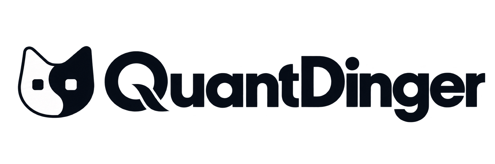
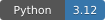
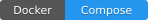
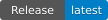

<div align="center">
  <a href="https://github.com/OpenByteInc/QuantDinger">
    <picture>
      <source media="(prefers-color-scheme: dark)" srcset="docs/screenshots/logo-dark.png">
      
    </picture>
  </a>

  <h1>QuantDinger</h1>
  <p><strong>ระบบปฏิบัติการเทรดด้วย AI แบบโอเพนซอร์ส</strong></p>
  <p>แพลตฟอร์มโฮสต์เองที่เปลี่ยนแนวคิดการเทรดให้เป็นกลยุทธ์ Python การทดสอบย้อนหลัง การเทรดจำลอง การส่งคำสั่งจริง และการติดตามระบบ</p>
  <p><em>วิจัยด้วย AI → โค้ดกลยุทธ์ → ทดสอบย้อนหลัง → เทรดจำลอง/จริง → ติดตามระบบ</em></p>

  <p>
    <a href="README.md">English</a> · <a href="README_CN.md">简体中文</a> · <a href="README_TW.md">繁體中文</a> ·
    <a href="README_JA.md">日本語</a> · <a href="README_KO.md">한국어</a> · <a href="README_DE.md">Deutsch</a> ·
    <a href="README_FR.md">Français</a> · <a href="README_RU.md">Русский</a> · <a href="README_AR.md">العربية</a> ·
    <strong>ไทย</strong> · <a href="README_VI.md">Tiếng Việt</a>
  </p>

  <p>
    <a href="https://ai.quantdinger.com"><strong>แอปออนไลน์</strong></a> ·
    <a href="https://www.quantdinger.com"><strong>เว็บไซต์ทางการ</strong></a> ·
    <a href="README.md"><strong>เอกสารภาษาอังกฤษฉบับเต็ม</strong></a>
  </p>

  <p>
    <a href="LICENSE"></a>
    
    
    <a href="https://github.com/OpenByteInc/QuantDinger/releases/latest"></a>
  </p>
</div>

> เมื่อเปิดใช้งานการเทรดจริงอย่างชัดเจน QuantDinger สามารถส่งคำสั่งซื้อขายจริงได้ ควรเริ่มจากบัญชีจำลอง จำกัดสิทธิ์ของ API Key และตรวจสอบข้อกำหนดด้านกฎหมายและความเสี่ยงในประเทศของคุณ โครงการนี้ไม่ใช่คำแนะนำการลงทุน

## ตัวอย่างการใช้งาน

<p align="center">
  
</p>

## QuantDinger คืออะไร?

QuantDinger คือ **ระบบปฏิบัติการเทรดด้วย AI แบบโอเพนซอร์ส** สำหรับเทรดเดอร์อิสระ นักพัฒนากลยุทธ์ Python และทีมขนาดเล็ก สถาปัตยกรรมแบบ local-first และโฮสต์เองช่วยให้ข้อมูลตลาด โค้ดกลยุทธ์ ข้อมูลรับรองโบรกเกอร์ และการติดตั้งอยู่ภายใต้การควบคุมของผู้ดูแลระบบ

## ความสามารถหลัก

- วิจัยตลาดด้วยผู้ให้บริการ AI หลายราย รายงานระดับมืออาชีพ และกลุ่มสินทรัพย์ที่นำกลับมาใช้ได้
- Strategy API V2 สำหรับอินดิเคเตอร์ Python กลยุทธ์ CTA และพอร์ตโฟลิโอ
- แบ็กเทสต์บนเซิร์ฟเวอร์ วิจัยปัจจัย วิวัฒนาการกลยุทธ์ และวิเคราะห์ความทนทาน
- ส่งคำสั่งแบบจำลองและจริงผ่านตลาดคริปโตและโบรกเกอร์แบบดั้งเดิม
- Web, Mobile H5, Human API, Agent Gateway และ MCP
- การจัดเก็บด้วย PostgreSQL เวิร์กเกอร์แบบกระจาย บันทึกการตรวจสอบ และระบบติดตามเสริม

QuantDinger ไม่ใช่บริการสัญญาณแบบกล่องดำ ผู้ดูแลระบบยังคงควบคุมโค้ดกลยุทธ์ การตั้งค่าความเสี่ยง ข้อมูลรับรอง และการติดตั้ง

## เริ่มต้นอย่างรวดเร็ว

สิ่งที่ต้องมี: Docker และ Compose v2 หากใช้อิมเมจที่สร้างไว้แล้ว ไม่ต้องติดตั้ง Node.js หรือ Python ในเครื่อง

Linux / macOS:

```bash
curl -fsSL https://raw.githubusercontent.com/OpenByteInc/QuantDinger/main/install.sh | bash
```

Windows PowerShell:

```powershell
irm https://raw.githubusercontent.com/OpenByteInc/QuantDinger/main/install.ps1 | iex
```

หลังติดตั้ง เปิดใช้งานได้ที่:

- Web: <http://127.0.0.1:8888>
- Mobile H5: <http://127.0.0.1:8889>
- ตรวจสอบ API: <http://127.0.0.1:5000/api/health>

## เอกสารและชุมชน

- [README ภาษาอังกฤษฉบับเต็ม](README.md) / [README ภาษาจีน](README_CN.md)
- [เอกสาร API](docs/api/README.md) / [AI Agent และ MCP](docs/agent/README.md)
- [คู่มือพัฒนากลยุทธ์](docs/trading/STRATEGY_DEV_GUIDE.md) / [แก้ไขปัญหาการติดตั้ง](docs/deployment/INSTALL_TROUBLESHOOTING.md)
- [Telegram](https://t.me/quantdinger) / [Discord](https://discord.com/invite/tyx5B6TChr) / [YouTube](https://youtube.com/@quantdinger)

## สัญญาอนุญาต

แบ็กเอนด์ใช้ [Apache License 2.0](LICENSE) ส่วน Web frontend และ mobile client ใช้สัญญาอนุญาตแบบเปิดเผยซอร์สของตนเอง โปรดดูข้อกำหนดการใช้เครื่องหมายการค้าและแบรนด์ที่ [TRADEMARKS.md](TRADEMARKS.md)
